# Hi there, I'm João Vitor Givisiez Lessa! 

### 🤖 Computer Science Student · AI & Software Engineering

I'm an undergraduate student studying **Computer Science** at the **Federal University of Lavras (UFLA)**, currently working as a **Software Development Intern at Druid**, focused on Java and AWS. I build software end to end — from data pipelines and machine learning models to APIs, CI/CD and cloud deployments — and my main interest is **turning AI into real products**.

---

## 🧠 Featured AI & Data Projects

### ♟️ [Othello with LLM Agents — LangGraph + Tools](https://github.com/joao-givisiez/othello-agentes-llm)
LLM agent built with **LangGraph** that plays Othello through a *perceive → reason → use tools → act* loop, compared against classical AI agents in a tournament.

- 🛠️ **Tool calling:** `get_valid_moves`, `make_move`, `simulate_move`, `analyze_moves` and `minimax_search` exposed to the LLM, which explains every move it makes
- 🧠 **Agent design:** game memory via checkpointer, re-prompting when the LLM doesn't play, safe fallback move and retry on API errors
- 🤖 **Classical baselines:** random, greedy, heuristic and Minimax with alpha-beta pruning over a bitboard game engine
- 📊 **Experiments:** round-robin tournament with metrics and generated reports, a configurable LLM provider (including Groq), tests and a Tkinter GUI

`Python` `LangGraph` `LLMs` `Tool Calling` `Minimax` `pytest`

### 📐 [KNN from Scratch vs. Scikit-learn](https://github.com/joao-givisiez/KNN)
K-Nearest Neighbors implemented without ML libraries (distances, neighbor selection, majority vote, tie-breaking and evaluation metrics), validated against Scikit-learn on the Iris dataset: **identical predictions (45/45)** and **95.6% accuracy** for k = 5 and 7.

`Python` `NumPy` `Machine Learning` `scikit-learn`

### 🩺 [Ischemic Heart Disease Mortality — Predictive ML + Explainable AI](https://github.com/joao-givisiez/Ciencia_e_Analise_de_dados)
End-to-end data science project that integrates **9 public datasets** (DATASUS, IBGE, IPEA, PNUD, CNES, VIGITEL) to predict mortality rates in Brazilian states from socioeconomic indicators.

- 🔧 **Pipeline:** data cleaning, integration and feature engineering with Pandas
- 🌲 **Modeling:** Random Forest tuned with `GridSearchCV` and 5-fold cross-validation — **R² = 74%** for the adults/elderly model
- 🔍 **Explainable AI:** SHAP values to show *why* the model predicts what it predicts (Gini as risk factor, HDI as protective factor)
- 🚀 **Deployment:** serialized models (`joblib`) served in an interactive **Streamlit** dashboard with a policy-scenario simulator — [live demo](https://erue9xjj8xotiktccy8ino.streamlit.app/)

`Python` `scikit-learn` `SHAP` `Pandas` `Plotly` `Streamlit`

### 🚚 [Hybrid Heuristic for the Capacitated Arc Routing Problem](https://github.com/joao-givisiez/Algoritmo-em-Grafos)
Optimization algorithm for logistics routing: graph modeling with cached Dijkstra shortest paths, a constructive heuristic for a feasible initial solution and **Variable Neighborhood Search (VNS)** for improvement, benchmarked on classic CARP instances.

`Python` `Graphs` `Metaheuristics` `Optimization`

---

## ⚙️ Software Engineering Projects

| Project | What it shows | Stack |
|---|---|---|
| [Projeto-Comp](https://github.com/joao-givisiez/Projeto-Comp) | CI/CD pipeline with automated tests and Docker image deploy | Node.js · Jest · GitHub Actions · Docker |
| [Compiladores](https://github.com/joao-givisiez/Compiladores) | Lexical and syntactic analyzers (Flex/Bison) and a hand-written transition-diagram scanner | C · Flex · Bison |
| [Sequence Set](https://github.com/joao-givisiez/Indexa-o-em-Sistemas-de-Informa-o) | Generic block-based binary file storage with insert, search, delete and listing | C++ |
| [ConectaU](https://github.com/joao-givisiez/ConectaU) | Team project: microservices architecture, REST API (OpenAPI) and CQRS documentation | Architecture · OpenAPI |
| [Personal Page](https://github.com/joao-givisiez/proWeb2-personal_page) | Portfolio page in two versions (Bootstrap and Bulma) with theme switching | HTML · CSS · JS |

---

## 👨‍💻 About Me

- 💼 Working with **Java, Maven, Docker and AWS** on daily development, architecture and cloud deployments.
- 🔬 Undergraduate researcher in **AI, NLP and LLMs** — from human–robot interaction to autonomous agents.
- 🌱 Currently deepening my studies in **Machine Learning, LLMs** and **cloud architecture**.
- 💬 Comfortable working in agile teams and writing clear technical documentation, in Portuguese or English.

---

## 🛠️ Languages and Tools

### 🧠 Data Science, AI & Machine Learning

  
  
  
  
  
  

### 💻 Languages

  

### ☁️ Cloud & DevOps

  
  

### 🔧 Tools & Utilities

  
  

---

## 🌍 Connect with me

